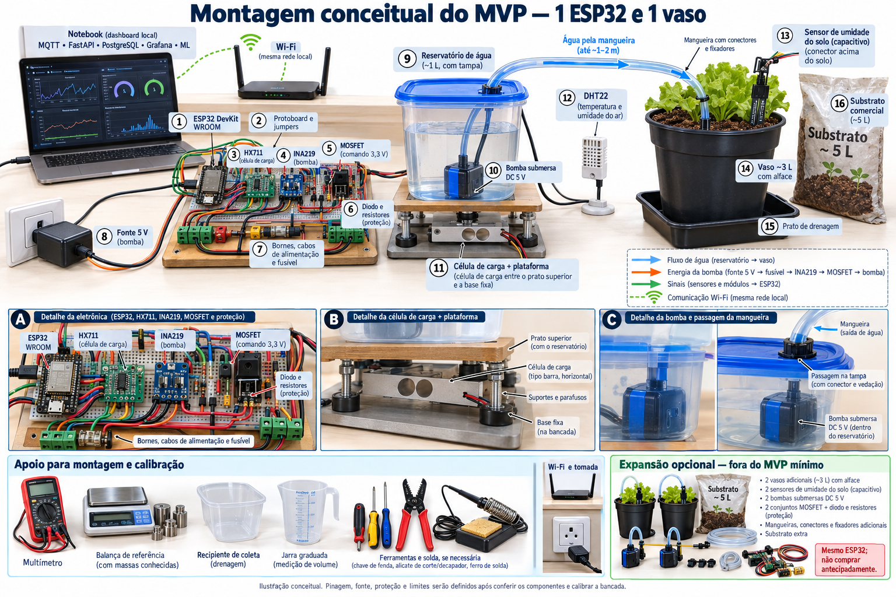

# TCC de irrigação inteligente

Execução prática de um protótipo de baixo custo com ESP32, sensores, controle de bomba e aprendizado de máquina. Entrega em **01/12/2026**. Redação acadêmica fora do escopo.

Ilustração conceitual; ligações elétricas e montagem da pesagem dependem dos componentes e da calibração.

[Diagrama interativo do ensaio contínuo](.archify/workflow-ensaio-continuo-20261012-210000/ensaio-continuo.html).

Pastas anteriores em `.archify/` são versões históricas; o link acima identifica o fluxo atual.

## Documentação

- [MVP](docs/mvp.md): definição, funcionamento e critérios de demonstração.
- [Materiais](docs/materiais-tcc.md): quantidades, funções e reaproveitamento.
- [Tarefas](docs/tasks-tcc.md): checklist até a entrega prática.
- [Ambiente local](docs/ambiente-local.md): execução, acesso e testes.
- [Protocolo de testes](docs/protocolo-testes.md): tratamentos, medição compartilhada, métricas e calendário.
- `docs/referencias/`: três documentos originais preservados.

## Escopo e estado

Arquitetura prática aprovada: ESP32/C++/ESP-IDF, MQTT/Mosquitto, Python/FastAPI, PostgreSQL, Grafana, pesagem com célula/HX711, medição de energia com INA219/INA226 e acionamento por MOSFET. Treinamento separado da inferência; decisão determinística e proteções locais no ESP32.

Software verificado com dados simulados em 12/10/2026: ingestão, controle T1/T2/T3, confirmação de ciclos, contingência, treinamento/inferência, painéis e restauração de backup. Firmware ESP-IDF preparado com núcleo de segurança; drivers, montagem, calibração e validação física ainda pendentes. O estado dos serviços deve ser consultado com `docker compose ps`.

Decisão aprovada: **opção A — 30 dias contínuos, um ESP32 e três vasos**, um por T1/T2/T3, com bombas sequenciais e medidores compartilhados. Orçamento fixo, sem ampliação de materiais ou troca de plantas na quinzena. Resultados descritivos com n=1 por tratamento; os períodos de 15 dias não são réplicas. Backend, simulador e núcleo do firmware foram adaptados para três unidades; operação física depende dos drivers e calibração. Configuração de referência: `config/experiment.json`.

Orçamento limitado ao conjunto atual; modelos dos componentes ainda não definidos. Fonte, acionamento e pinagem dependem das peças reais. Cultura sugerida: alface em vasos de cerca de 3 litros; confirmar condições de bancada e calibração.

Planejamento atual: bancada e modelo prontos até 31/10; comparação de 01/11 00:00 a 01/12 00:00 (São Paulo), com análise incremental durante novembro. Entrega em 01/12 deixa poucas horas após os 30 dias completos. Depende de aquisição, calibração e dados úteis; replanejar se não for viável. Metas de economia >20%, MAE <3 pontos e conformidade ≥95% são expectativas, não resultados garantidos. Grafana centraliza os painéis por vaso/período, qualidade, ciclos e intervenções; resultados físicos continuam pendentes.

## Estrutura

`firmware/`: ESP32; `backend/`: ingestão e serviços; `infra/`: configurações; `tests/`: testes; `tools/`: scripts; `data/`: dados; `models/`: modelos; `docs/`: documentação.
