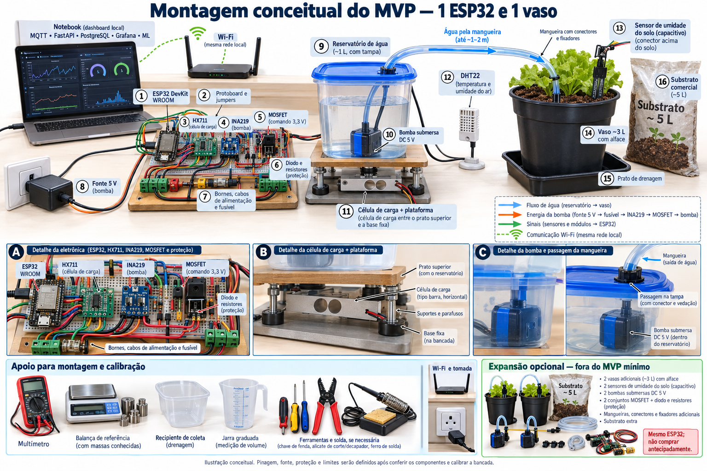

# MVP de irrigação inteligente

[Abrir diagrama interativo do funcionamento](../.archify/workflow-fluxo-mvp-20261012-162340/fluxo-mvp.html).

Imagem gerada com imagegen a partir da lista de materiais: bancada com um ESP32, um vaso, reservatório pesado, sensores, acionamento e notebook; instrumentos de apoio e expansão opcional separados. É uma visualização conceitual, não esquema elétrico ou desenho mecânico validado. Cabo USB de dados liga notebook e ESP32; conferir essa ligação na montagem. A plataforma real deve transmitir o peso pela célula, sem apoios paralelos ou tração de fios/mangueiras que desviem a carga. Pinagem e componentes de potência dependem das peças escolhidas.

O MVP é um protótipo de bancada com **um ESP32, um vaso e uma bomba**, conectado a uma aplicação executada em notebook. Seu objetivo é demonstrar o ciclo completo de irrigação: medir, transmitir, prever, decidir, irrigar e registrar o resultado.

A entrega inclui montagem, software, calibração, testes e documentação técnica. Não inclui a criação do texto acadêmico.

## Componentes e responsabilidades

| Parte | Responsabilidade |
| --- | --- |
| Sensor de solo e DHT22 | Medir condição de umidade do substrato, temperatura e umidade do ar. |
| ESP32 | Ler sensores, transmitir dados, receber comandos e controlar a bomba com proteções locais. |
| Célula de carga e HX711 | Pesar o reservatório para estimar água retirada por ciclo. |
| INA219 | Medir tensão e corrente do ramo da bomba para calcular energia. |
| MOSFET e bomba | Acionar a irrigação e transportar água ao vaso. |
| MQTT/Mosquitto | Transportar telemetria, comandos e confirmações com TLS e autenticação. |
| Backend Python/FastAPI | Validar e registrar dados, executar previsão e aplicar regras de decisão. |
| PostgreSQL | Armazenar leituras, previsões, decisões, comandos e resultados. |
| Grafana | Mostrar medições, estado do sistema e histórico de irrigação. |

## Fluxo de funcionamento

1. **Medir:** o ESP32 coleta solo e ambiente. Cada leitura identifica dispositivo, vaso, horário, calibração e validade.
2. **Transmitir:** envia os dados ao backend pelo MQTT. O backend valida e persiste sem duplicar mensagens reenviadas.
3. **Prever:** no modo preditivo, um modelo previamente treinado estima a umidade no horizonte de seis horas. A previsão registra versão do modelo e condições utilizadas.
4. **Decidir:** regras determinísticas avaliam previsão, umidade atual, validade dos dados, água disponível e limites de operação. O modelo não liga a bomba diretamente.
5. **Comandar:** quando necessário, o backend envia um comando identificado, com validade e limites de volume/duração.
6. **Validar e irrigar:** o ESP32 confere o comando e suas proteções locais. Informa aceitação ou rejeição e, quando executado, início e conclusão do ciclo.
7. **Medir o resultado:** registra água retirada do reservatório e energia do ramo da bomba. Leituras instáveis ou ausentes são identificadas, não convertidas em consumo zero.
8. **Exibir:** o painel apresenta o histórico, motivo da decisão, medições e eventuais falhas.

O volume retirado é estimado pela diferença de massa estabilizada antes/depois do ciclo, usando a densidade adotada. A energia é calculada pela integração de tensão × corrente ao longo do tempo. Calibração e coleta de referência devem verificar a água efetivamente entregue ao vaso.

## Modos de operação

| Modo | Funcionamento |
| --- | --- |
| T1 — agendamento fixo | Irriga nos horários e volumes previamente definidos. |
| T2 — limiar com histerese | Irriga conforme limites calibrados, evitando alternância frequente de acionamento. |
| T3 — preditivo | Usa previsão de umidade e regras determinísticas para decidir momento e volume. |
| Contingência local | Quando o modo remoto/preditivo fica indisponível, usa histerese local somente com sensores, água e configuração válidos. |

O vaso pode demonstrar os modos separadamente. Alternar modos no mesmo vaso não constitui, por si só, um experimento comparativo independente entre tratamentos.

## Proteções e continuidade

- Bomba desligada na inicialização e ao atingir o limite máximo do ciclo.
- Bloqueio por leitura inválida, água insuficiente ou comando fora dos limites.
- Rejeição de comandos vencidos e prevenção de reexecução de duplicatas.
- Watchdog e registro de falhas; confirmação MQTT não equivale a confirmação de irrigação.
- Buffer limitado de telemetria durante desconexão, com reenvio preservando o horário original.
- Retorno sincronizado ao modo remoto, sem executar comandos antigos nem sobrepor ciclos locais.

Pinagem, limites, frequência de amostragem e parâmetros de histerese serão definidos após conferir os componentes e calibrar a bancada.

## Demonstração esperada

- [ ] Leituras físicas válidas chegam ao banco e aparecem no painel.
- [ ] Uma previsão real do modelo participa da decisão em T3.
- [ ] A bomba executa um ciclo autorizado e retorna confirmações.
- [ ] Água e energia do ciclo são registradas com suas referências de calibração.
- [ ] Comandos duplicados, vencidos e inválidos não provocam atuação indevida.
- [ ] Desconexão demonstra contingência e recuperação dentro dos limites documentados.
- [ ] O histórico permite ligar leitura, previsão, decisão, comando e resultado.

Treinamento depende de dados físicos preliminares suficientes. Dados simulados servem aos testes de integração e permanecem identificados; não comprovam desempenho físico ou economia hídrica.

## Limites e estado atual

O índice calibrado do sensor não será chamado de umidade volumétrica sem calibração apropriada. A pesagem mede retirada do reservatório, e a medição elétrica cobre o ramo da bomba. Chuva externa não molha o vaso coberto e deve ser tratada separadamente em simulação.

Um vaso é suficiente para demonstrar este MVP. A comparação T1/T2/T3 por pelo menos 30 dias prevista no pré-projeto exige protocolo próprio, definido com o orientador. Economia superior a 20%, MAE inferior a três pontos e conformidade de 95% são metas a avaliar, não garantias do protótipo.

**Estado registrado em 12/10/2026:** fluxo de software, controles T1/T2/T3, ML, contingência e registros verificados em simulação. Firmware preparado sem drivers físicos; atuação física permanece bloqueada. Montagem, calibração, treinamento com dados reais e medições físicas ainda pendentes. Previsão estima solo observado sob a política coletada; não representa automaticamente um cenário sem irrigação.

Documentos relacionados: [materiais](materiais-tcc.md), [tarefas](tasks-tcc.md) e [ambiente local](ambiente-local.md).
